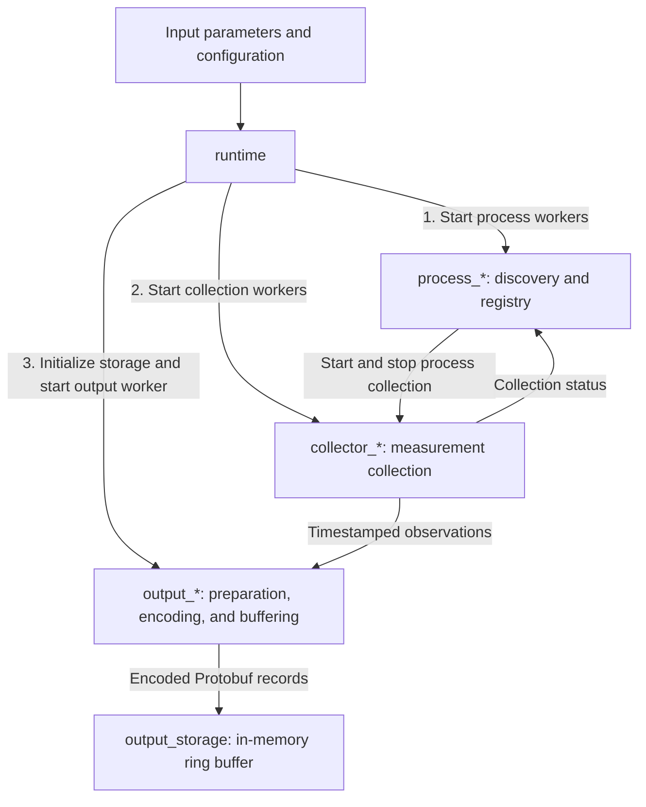
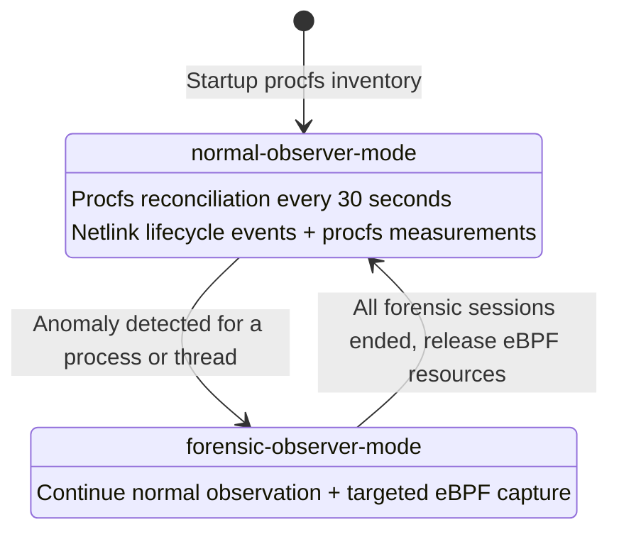
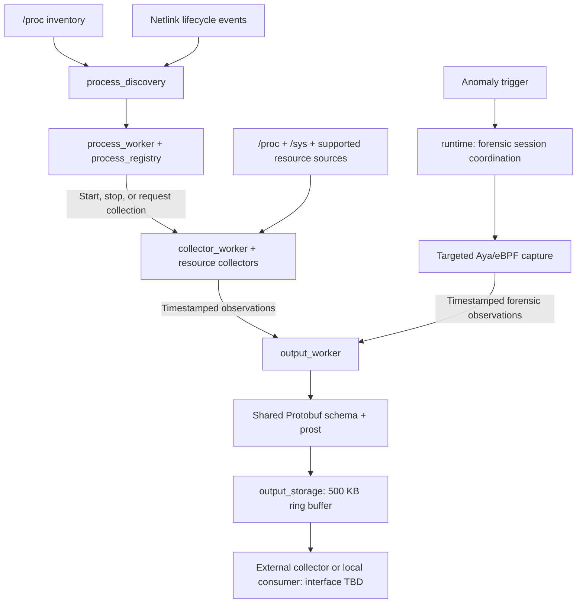

# rdk-observer-rs

`rdk-observer-rs` is a system process observer for RDK devices. Its goal is to discover processes, collect resource measurements, and prepare Protobuf records for an external collector or local processing consumer.

The executable entry point and observation data types are implemented. The Protobuf schema, encoding/decoding, process discovery, resource collectors, workers, buffering, and delivery remain a project scaffold documenting the intended design.

## Problem solved

RDK-Observer is intended to provide continuous, low-overhead observability of CPU, DRAM, processes, network, and I/O activity across an RDK device.

On a resource-constrained device, the goal is to understand **where the available resources are going** and which processes or kernel activities consume them. Combining system metrics, process-level information, and Linux observability mechanisms will help track resource use over time, correlate transient events with their likely cause, evaluate the efficiency of current components, and support future architectural decisions.

Tools such as `top` and `htop` provide an immediate view of resource use. RDK-Observer will collect timestamped observations continuously and prepare compact telemetry for long-term analysis, allowing consumers to identify gradual memory growth, recurring load patterns, intermittent peaks, and changes in process behavior.

Periodic sampling can miss processes that start and exit between snapshots. Netlink lifecycle notifications will complement procfs snapshots during normal observation, while targeted Aya/eBPF capture will add detail after anomaly detection. Event loss or unavailable netlink support can still leave short-lived processes undiscovered.

## Comparison of rdk-observer-rs with the Existing RDK Monitoring Stack

### Overview

`rdk-observer-rs` is an event-driven system monitor. It reacts to process fork,
exec, comm, and exit events as they happen, updates its process registry, and
collects per-process CPU, memory, and I/O metrics. In parallel, it collects
system-wide CPU, memory, and block-device I/O metrics. A periodic `/proc`
reconciliation complements event tracking.

CPUProcAnalyzer and MemInsight are two snapshot-based specialized components.
CPUProcAnalyzer performs process discovery and metric collection through shell
commands. It periodically checks configured process names and collects CPU and
basic resource usage. MemInsight periodically scans `/proc` and creates detailed
system and process memory snapshots. They overlap for some CPU and memory
metrics but otherwise serve different purposes.

### Metric coverage

| Category | rdk-observer-rs | CPUProcAnalyzer + MemInsight |
|---|---|---|
| System CPU | ✅ | ✅ |
| Process CPU | ✅ | ✅ |
| System memory | ✅ | ✅ |
| Process memory | ✅ | ✅ |
| Process I/O | ✅ | ❌ |
| System storage I/O | ✅ | ❌ |
| System network | <span style="color:#d4a000">In Progress</span> | ❌ |
| System pressure | <span style="color:#d4a000">In Progress</span> | ❌ |
| Event-based collection | ✅ | <span style="color:#d4a000">EXEC snapshot only</span> |
| Netlink process lifecycle | ✅ Fork/Exec/Comm/Exit | <span style="color:#d4a000">EXEC snapshot only</span> |
| Short-lived process discovery | ✅ | <span style="color:#d4a000">Partial</span> |
| PID reuse-safe identity | ✅ | ❌ |
| Adaptive collection intervals | ✅ | ❌ |
| Output | <span style="color:#d4a000">Protobuf binary records (In Progress)</span> | ✅ Text/CSV/JSON/T2 |

### Functional differences

#### rdk-observer-rs

- provides system and process CPU, memory, process I/O, and block-device I/O in
  one runtime;
- collects metrics directly in-process without invoking shell commands;
- reacts to fork, exec, comm, and exit events through netlink instead of waiting
  for the next periodic scan;
- reconciles the event-driven process registry with `/proc` periodically;
- detects short-lived processes and protects against incorrect attribution
  after PID reuse;
- supports separate system, initial-process, and ongoing-process collection
  intervals.

#### CPUProcAnalyzer + MemInsight

- CPUProcAnalyzer uses shell commands for process discovery and metric
  collection, and provides file-descriptor counts, load-average, RDK
  client-specific statistics, and process and thread text output;
- MemInsight provides detailed `smaps` fields, page-fault reports, and CSV,
  JSON, or T2 output.

### Resource usage

The results in this table were collected with a metric collection interval of
<u><strong>1 second</strong></u>.

| Component | CPU | CPU time | Peak memory usage | Processes, max | Threads, max |
|---|---:|---:|---:|---:|---:|
| rdk-observer-rs | 38.6% | 23,149.46 ms | 1,648 KiB | 1 | 10 |
| CPUProcAnalyzer + MemInsight | 73.9% | 44,372.46 ms | 7,764 KiB | 6 | 11 |

CPU usage by collection interval:

| Collection interval | rdk-observer-rs CPU | CPUProcAnalyzer + MemInsight CPU |
|---:|---:|---:|
| 1 s | 38.6% | 73.9% |
| 2 s | 23.1% | 77.4% |
| 5 s | 12.5% | 67.5% |
| 10 s | 7.1% | 65.9% |

#### CPU

At one second, `rdk-observer-rs` used approximately 1.9 times less CPU. At ten
seconds, it used approximately 9.3 times less CPU.

#### RAM

The kernel-recorded cgroup peak was 1,648 KiB for `rdk-observer-rs` and 7,764
KiB for CPUProcAnalyzer and MemInsight together.

#### Processes and threads

`rdk-observer-rs` stayed at 1 process and 10 threads throughout the test. The 10
threads are 1 main thread and 9 Tokio runtime or blocking workers.

CPUProcAnalyzer normally runs as 1 process with 4 threads, while MemInsight runs
as 1 process with 1 thread. Short-lived shell and helper processes increased the
highest captured values to 6 processes and 11 threads.

### Context switches and page faults

| Component | Context switches | Page faults | Major page faults |
|---|---:|---:|---:|
| rdk-observer-rs | 129,361 | 2,509 | 0 |
| CPUProcAnalyzer + MemInsight | 32,769 | 166,479 | 0 |

### Test environment

- architecture: AArch64 GNU/Linux;
- operating system: RDK 6.1 (kirkstone);
- Linux kernel: 5.15.162;
- CPU: 1 virtual Cortex-A53;
- RAM: 996,908 KiB;
- swap: disabled;
- cgroup v1 CPU, memory, pids, and perf-event controllers: available;
- `/proc/<pid>/io`: available;
- `/proc/<pid>/smaps_rollup`: available.

### Resource usage benchmark methodology

Each option was measured at collection intervals of 1, 2, 5, and 10
seconds.

CPUProcAnalyzer and MemInsight were placed in the same cgroup. All their
processes, threads, and inherited helper processes were therefore included in
the result. `rdk-observer-rs` was measured in a separate cgroup using the same
method.

#### Existing stack

CPUProcAnalyzer:

```text
SleepInterval = <interval>
TimeToRun = 0
DynamicProcess = 1
MonitorAllProcess = 0
MemoryLimit = 65536
```

MemInsight:

```text
meminsight \
    --iterations 700 \
    --interval <interval> \
    --fmt csv \
    --output <meminsight-directory>
```

#### rdk-observer-rs

```text
rdk-observer --system-collection-interval <interval> \
    --process-collection-interval-initial <interval> \
    --process-collection-interval-ongoing <interval>
```

#### Resource measurement

CPU, scheduler events, peak memory, process count, and thread count were
measured for the complete cgroup.

```text
perf stat -x, -a -G /<cgroup> \
    -e task-clock,context-switches,cpu-migrations,page-faults,minor-faults,major-faults \
    -- sleep 60

cat /sys/fs/cgroup/memory/<cgroup>/memory.max_usage_in_bytes
wc -l < /sys/fs/cgroup/pids/<cgroup>/cgroup.procs
wc -l < /sys/fs/cgroup/pids/<cgroup>/tasks
```

### Benchmark command outputs

The following output is from the one-second runs.

#### Existing stack

```console
$ echo 0 > /sys/fs/cgroup/memory/rdk-bench-existing-stack-1-366761/memory.max_usage_in_bytes
$ perf stat -x, -a -G /rdk-bench-existing-stack-1-366761 \
    -e task-clock,context-switches,cpu-migrations,page-faults,minor-faults,major-faults \
    -- sleep 60
44372.46,msec,task-clock,/rdk-bench-existing-stack-1-366761,44378536656,100.00,0.739,CPUs utilized
32769,,context-switches,/rdk-bench-existing-stack-1-366761,44378536656,100.00,738.499,/sec
0,,cpu-migrations,/rdk-bench-existing-stack-1-366761,44378536656,100.00,0.000,/sec
166479,,page-faults,/rdk-bench-existing-stack-1-366761,44378536656,100.00,3.752,K/sec
166479,,minor-faults,/rdk-bench-existing-stack-1-366761,44378536656,100.00,3.752,K/sec
0,,major-faults,/rdk-bench-existing-stack-1-366761,44378536656,100.00,0.000,/sec

$ cat /sys/fs/cgroup/memory/rdk-bench-existing-stack-1-366761/memory.max_usage_in_bytes
7950336
$ wc -l < /sys/fs/cgroup/pids/rdk-bench-existing-stack-1-366761/cgroup.procs
6
$ wc -l < /sys/fs/cgroup/pids/rdk-bench-existing-stack-1-366761/tasks
11
```

#### rdk-observer-rs

```console
$ echo 0 > /sys/fs/cgroup/memory/rdk-bench-rdk-observer-1-369146/memory.max_usage_in_bytes
$ perf stat -x, -a -G /rdk-bench-rdk-observer-1-369146 \
    -e task-clock,context-switches,cpu-migrations,page-faults,minor-faults,major-faults \
    -- sleep 60
23149.46,msec,task-clock,/rdk-bench-rdk-observer-1-369146,23154394464,100.00,0.386,CPUs utilized
129361,,context-switches,/rdk-bench-rdk-observer-1-369146,23154394464,100.00,5.588,K/sec
0,,cpu-migrations,/rdk-bench-rdk-observer-1-369146,23154394464,100.00,0.000,/sec
2509,,page-faults,/rdk-bench-rdk-observer-1-369146,23154394464,100.00,108.383,/sec
2509,,minor-faults,/rdk-bench-rdk-observer-1-369146,23154394464,100.00,108.383,/sec
0,,major-faults,/rdk-bench-rdk-observer-1-369146,23154394464,100.00,0.000,/sec

$ cat /sys/fs/cgroup/memory/rdk-bench-rdk-observer-1-369146/memory.max_usage_in_bytes
1687552
$ wc -l < /sys/fs/cgroup/pids/rdk-bench-rdk-observer-1-369146/cgroup.procs
1
$ wc -l < /sys/fs/cgroup/pids/rdk-bench-rdk-observer-1-369146/tasks
10
```

## Planned tracking options

The observer will support the following process selection options:

- All user-space processes.
- Kernel processes, where the system exposes them through `/proc`.
- User-space processes associated with RDK-B.
- Individually selected processes.

These options will allow deployments to choose between broad process monitoring and a selected subset. Normal observation will track processes; forensic observation may target individual threads within an anomalous process. System-wide resource totals will provide overall device context.

## Functional requirements

The following requirements describe planned functionality. Field definitions, supported sources, anomaly rules, and implementation stages still need to be specified where noted in the architecture below.

Resource monitors must attribute observations to the stable process identity (`PID + start_time`) whenever the kernel exposes reliable per-process data. System-wide metrics must provide device context. Metrics that cannot be attributed reliably to an individual process must remain identified as system-wide observations. Unavailable measurements must remain distinguishable from zero.

### Process registry

- Track running processes and their lifecycle.
- Maintain stable identity using PID and start time.
- Collect metadata such as name, executable, parent PID, and command line.
- Keep current and recent historical process information, with retention bounded by the memory budget.
- Track start time, end time, and current state when known.
- Provide a shared process registry to the collection workers.
- Minimize discovery overhead.

### CPU resource management

- Monitor overall CPU utilization and CPU usage per process.
- Measure load and CPU pressure.
- Track user and system CPU time, context switches, and CPU migrations where available.
- Collect relevant perf/PMU counters where supported and enabled by the capture policy.
- Detect short CPU peaks and unusual CPU activity within the limits of the configured sampling and capture policy.

### DRAM resource management

- Monitor total, available, and used DRAM.
- Track per-process RSS, PSS, private memory, and shared memory.
- Monitor page cache and kernel slab usage.
- Track memory pressure using PSI.
- Monitor page faults, reclaim, and other memory activity where exposed.
- Detect memory growth, peaks, and potential out-of-memory conditions.

### Storage resource monitor

- Monitor system storage read/write activity and per-process I/O.
- Track bytes read and written, read and write operations, throughput, and latency where available.
- Track I/O pressure using PSI.
- Detect processes generating unusually high storage activity.

### Network resource monitor

- Monitor traffic per network interface and per-process network use where reliable attribution is available.
- Track RX/TX bytes and packets, packet drops, and errors.
- Track interface state and link changes.
- Collect relevant network-stack statistics.
- Detect unusual traffic or network resource consumption.

Network and pressure collection remain planned extensions. Sources requiring eBPF must follow the forensic activation policy; they must not introduce routine eBPF attachment in normal mode.

### Aggregation and metrics management

- Receive observations from the enabled collection workers.
- Correlate CPU, DRAM, network, and I/O information with validated process identities.
- Maintain bounded short-term history.
- Calculate configured averages, peaks, deltas, rates, and trends.
- Reduce high-frequency samples into compact telemetry where configured.
- Allow collection frequency and export frequency to be configured independently.
- Track the observer's own CPU, memory, storage, and collection overhead.

These requirements do not introduce a separate central Metric Collector Worker. Collection tasks will calculate configured CPU utilization and I/O rates; `output_worker` will prepare records. Ownership and retention policies for additional historical aggregation, averages, peaks, and trends remain to be defined within the resource budget. Export scheduling belongs to the consuming or delivery component, whose interface is still open.

### External collector and analysis

The intended external consumer will collect and store observations, provide dashboards and initial analysis, and potentially supply data to an AI model for deeper analysis. These downstream functions are separate from the observer's measurement collection, encoding, and buffering responsibilities. A local processing consumer may also use the same Protobuf records.

## Deliverables

The component should have measurable storage, CPU, and DRAM limits and support portability across RDK-B platforms.

### Initial resource targets

The initial targets under normal operation are approximately:

| Resource | Target |
| --- | --- |
| Storage footprint | At most 5 MB |
| DRAM usage | At most 10 MB |
| CPU utilization | Below 5% |

Deployment is intended to use a dedicated **cgroup** so resource usage can be measured and limits enforced where appropriate. These are design targets to validate on target devices. CPU accounting conventions, workload, and platform-specific acceptance criteria remain to be defined. Forensic capture will need explicit duration and resource limits.

The planned 500 KB output ring buffer, including its bookkeeping, is part of the overall DRAM budget.

## Architecture

The target architecture is a single Rust process built around the Tokio asynchronous runtime. Tokio tasks and `mpsc` channels will separate process discovery, collection, and output handling while keeping monitoring overhead suitable for a resource-constrained RDK gateway.


The program separates target management, measurement collection, and output handling:

| Modules | Responsibility |
| --- | --- |
| `process_*` | Discover candidate processes, select targets, maintain the process registry, and coordinate process collection. |
| `collector_*` | Collect measurements for registered targets or system totals, calculate configured derived values, and report collection status. |
| `output_*` | Prepare observation records, encode Protobuf, and store encoded records in the output buffer. |
| `config` | Represent input options, including target selection, resources, sampling, forensic capture policy, and record preparation. |
| `runtime` | Start and connect the required Tokio workers, manage their lifecycle, and coordinate observer mode transitions. |

The entry point will eventually read input parameters, build and validate configuration, and launch the configured `runtime`. Configuration will determine which processes and resources to monitor, the collection scope, and which raw and derived measurements to include in records.



### Observer modes

The observer will start in `normal-observer-mode`. It will discover existing processes with an initial `/proc` inventory snapshot, reconcile that inventory every 30 seconds, and use the Linux netlink process connector (`NETLINK_CONNECTOR` / `CN_PROC`) for fork, exec, and exit notifications between scans. Normal mode will collect procfs resource measurements without loading or attaching eBPF programs. Netlink will be the normal lifecycle event source.

A qualifying anomaly will move the observer into `forensic-observer-mode` while normal collection continues. See [Forensic mode](#forensic-mode) for the session lifecycle and proposed triggers.



### Process targets

`process_discovery` will subscribe to netlink lifecycle notifications before the startup inventory scan when the connector is available. It will forward scan results and events to `process_worker`, which will deduplicate them by process identity. Reconciliation every 30 seconds will discover missed processes and remove confirmed stale entries. Inventory scans identify targets; their cadence is independent of resource sampling intervals.

`process_worker` will apply selection rules, update `process_registry`, and coordinate collection for the selected targets. The registry will identify each process by PID and start time so PID reuse does not attach an old process's history to a new one. The coordinator will use process lifecycle events to start and stop per-process collection tasks and combine repeated collection requests. Collection tasks will report completion, target disappearance, and failures to the coordinator so it can reconcile collection state with the registry.

Netlink events include thread identifiers and thread-group identifiers, so a thread exit must not be treated as the exit of the whole process. Delayed events must not remove a newer process that reused a PID. If netlink is unavailable or loses events, discovery will continue through procfs reconciliation and report reduced lifecycle coverage; eBPF will remain reserved for anomaly-triggered forensics. Short-lived processes may be missed when events are unavailable or lost. [ADR-0003](docs/architecture/adr/0003-trigger-process-capture-with-bpf-events.md) defines discovery, recovery, and forensic mode boundaries.

### Snapshot sources

The planned snapshot path will read Linux information exposed through `/proc` and `/sys`. The `procfs` crate will provide access to process and system resource data. Typical sources include:

| Source | Intended measurements |
| --- | --- |
| `/proc/stat` | System CPU counters |
| `/proc/meminfo` | System DRAM, cache, and slab information |
| `/proc/diskstats` | System storage activity |
| `/proc/pressure/*` | CPU, memory, and I/O pressure |
| `/proc/<pid>/stat` | Process identity, CPU counters, and page faults |
| `/proc/<pid>/status` | Process status and memory information |
| `/proc/<pid>/smaps_rollup` | PSS and detailed memory accounting where available |
| `/proc/<pid>/io` | Per-process I/O counters |

`/sys` will complement procfs with network interface and device statistics, hardware information, thermal information, and platform-specific attributes where relevant. Network collection may also use netlink and kernel network statistics. Interface-level observations remain system-wide unless a source supports reliable process attribution.

### Measurement collection

`collector_worker` tasks will use the registered targets and enabled resource collectors. They will receive start and stop instructions from `process_worker` and report collection status back to it. Configuration will select collection for an individual process, a full pass over the selected process list, system totals, or a combination. `runtime` will coordinate independent system collection.

Resource modules such as `collector_cpu`, `collector_memory`, and `collector_io` will provide collection functions. For example, the CPU collector will support system counters from `/proc/stat` and per-PID counters from `/proc/<pid>/stat`. Per-process memory and I/O fields still need to be defined. Network and pressure collection are planned extensions; per-process measurements will require sources that support that attribution, and unavailable measurements will remain distinguishable from zero.

Per-process tasks will use adaptive sampling intervals, bounded jitter, and a shared read concurrency limit. Full-list requests will be coordinated with active tasks to avoid duplicate reads. System totals will be sampled independently when requested.

When configured, collection tasks will derive CPU utilization and I/O rates from consecutive valid samples. First samples establish baselines; counter resets or identity changes invalidate affected deltas. Collectors will send timestamped observations directly to `output_worker` through channels. A discovery scan identifies targets; a collection pass reads their measurements. A full process snapshot is a pass over the selected targets, not an atomic view of every process or the whole system.

### Sampling strategy

Sampling will use two complementary paths:

1. **System resource snapshots** will collect device-wide state from sources such as `/proc/stat`, `/proc/meminfo`, `/proc/diskstats`, PSI, and `/sys` at an independently configurable frequency.
2. **Per-process sampling** will read only the relevant `/proc/<pid>/...` files for each selected process. Targeted reads may run more frequently than system collection or discovery scans. Every observation will carry its own timestamp and validated process identity where applicable.

The original sampling proposal supplies the following starting points for target-device evaluation. They are provisional values, not implemented defaults or replacements for the adaptive scheduling policy in ADR-0002:

| Metric | Initial per-process interval proposal |
| --- | --- |
| CPU | 1–2 seconds |
| I/O | 5 seconds |
| DRAM | 5–10 seconds |
| PSS | 15–30 seconds |
| Network | 5 seconds, where reliable attribution is available |

Cheap sources such as `/proc/<pid>/stat` may be read more frequently than expensive sources such as `/proc/<pid>/smaps_rollup`. Per-process tasks will stagger reads with bounded jitter and share a concurrency limit, spreading work across each interval. Asynchronous execution will keep coordination responsive; scheduling and concurrency controls will limit simultaneous kernel reads and artificial CPU or I/O peaks.

Collection intervals, the 30-second discovery reconciliation interval, and output consumption or reporting intervals are independent. For example, a consumer could export every 30 seconds while CPU is sampled every 1–2 seconds and PSS every 15–30 seconds. Export cadence and batching remain to be defined with the consuming component.

### Event-driven and forensic collection

Normal lifecycle notifications will update the Process Registry and let `process_worker` start, stop, or request prompt collection for a target. They will not create a separate monitoring task for every event.

Forensic sessions will feed timestamped eBPF observations into the output path described below. [Forensic mode](#forensic-mode)

### Output handling

`output_worker` will receive collected observations, prepare Protobuf records, and store them in the output buffer. Record preparation will preserve timestamps, process identities, raw and derived values, units, and unavailable measurements. Process lifecycle events will remain within discovery and collection coordination.

`output_model` defines Rust records for process and system memory, CPU, storage I/O, and network observations. Each per-process collection task will emit independent records for its target. Every `ObservationRecord` carries a required `process_identity`, its own wall-clock and monotonic timestamps, and one resource payload. The payload contains measurements and optional derived values with explicit units; process identity is stored once at the observation level. Sampling multiple processes does not require a shared collection-pass identifier. Unavailable measurements use `None` rather than zero. `output_encoding` will map these records to generated Protobuf messages and encode and decode them using `prost`. `output_storage` will hold encoded records in a planned in-memory ring buffer capped at 500 KB (500,000 bytes), including buffer bookkeeping.

The process output fields cover virtual/resident/proportional memory, user/system CPU ticks and optional CPU utilization, and storage bytes and read/write syscall counts. Storage records can also carry optional byte rates. Detailed I/O timings, logical I/O character counts, and cancelled writes are deferred.

`SystemRecord` carries its own wall-clock and monotonic timestamps and a `SystemResourceRecord` payload, without a process identity. Its variants hold aggregate CPU counters from `/proc/stat`, physical memory totals and availability from `/proc/meminfo` converted to bytes, a collection of block-device records from `/proc/diskstats`, or system network interface records from `/proc/net/dev`. CPU counters retain all ten time categories in clock ticks; guest counters overlap user/nice counters and must not be counted twice. Optional system CPU utilization uses 100% to represent all CPU capacity being busy. Each storage entry identifies its device by major/minor number and name and preserves completed read/write operation counts and raw 512-byte sector counts. These block operations are distinct from process I/O syscall counts. Device selection must avoid double-counting disks and partitions. Optional byte rates require two valid samples of the same device; first samples, resets, and device identity changes invalidate the baseline. 

`ResourceRecord::Threads(Vec<ThreadRecord>)` holds the collection of threads sampled for the process, including its main thread. Each entry carries its own TID/start-time identity, name, state, raw priority, nice value, last CPU number, voluntary/nonvoluntary context-switch counters, and optional CPU and storage measurements. The enclosing observation supplies the owning process identity and collection timestamp. The CPU and storage variants at the resource level describe the whole process; measurements inside a thread entry describe only that thread. Process and thread totals overlap and must not be added together. RSS and PSS remain at process level because threads share the address space. Thread counter baselines must reset when the process or thread instance changes. Threads can start or exit during enumeration, so the list is not an atomic snapshot or a complete lifecycle history. These types define the output representation; thread discovery and collection are not implemented yet.

Process records carry both an optional `logical_label` for correlating the same component across restarts and an optional `security_label` containing the security module name and reported context. Discovery will resolve logical labels from configured selection rules or service metadata; security profiles can be mapped explicitly when they identify a component reliably. Neither label is required for a process instance to be recorded. PID and start time identify each instance within a boot and PID namespace, and CPU and I/O counter baselines must reset for a new instance even when its labels match the previous one. Security labels are metadata and may be shared by multiple processes or change during an instance's lifetime. Label resolution and security-context collection are not implemented yet.

Buffered Protobuf records will be available for an external collector or local processing consumer using the same schema. The component responsible for consuming or delivering buffered records and its interface remain to be defined separately from record preparation and storage. Buffer overflow policy, input channel backpressure, and pending-record handling during shutdown also remain to be defined.

### Serialization and Protobuf encoding

Observation records will use Protocol Buffers, as decided in [ADR-0004](docs/architecture/adr/0004-observation-record-format-decision.md). The [shared schema](rdk-observer-core/proto/observation.proto) defines the wire messages and preserves identities, timestamps, and the distinction between unavailable measurements and measured zero.

Cargo runs the `rdk-observer-core` build script, which uses the `prost-build` build dependency to invoke `protoc` on `proto/observation.proto`. When the schema changes, Cargo reruns the script and regenerates `rdk.observer.v1.rs` in Cargo's `OUT_DIR`. [Build script](rdk-observer-core/build.rs)

`output_encoding.rs` declares the `proto` module and uses `include!` to compile the generated file from `OUT_DIR`. This makes types such as `ProcessRecord` and `SystemRecord` available under `rdk_observer_core::output_encoding::proto`. The `prost` dependency provides the `prost::Message` trait for encoding and decoding those types. [Module declaration](rdk-observer-core/src/output_encoding.rs)

Install `protoc` on `PATH` (`protobuf-compiler` on Debian and Ubuntu) or set `PROTOC` to the compiler's path. Use `protoc --version` to check the compiler on `PATH`.

The planned encoding flow is:

```text
Shared .proto schema
          |
          v
      prost-build
          |
          v
Rust message types
          |
          v
        prost
          |
          v
    Protobuf bytes
```

The planned observer encoding will convert `output_model` records to generated messages, preserving identities, timestamps, optional values, and thread collections. Transport message boundaries and batching remain to be defined. Keep schema field numbers stable and reserve removed field numbers and names before evolving the schema.

Protobuf had the smallest payloads and fastest encoding and decoding in the recorded ADR-0004 benchmark cases. Those results motivate the format choice; performance still needs validation with the actual schema and workload on target devices.

#### Verify the schema and bindings

From the repository root, validate the schema with `protoc`. The descriptor output goes to `/dev/null`, and a successful check exits silently.

```bash
protoc -I rdk-observer-core/proto \
  --descriptor_set_out=/dev/null \
  rdk-observer-core/proto/observation.proto
```

Check the Cargo integration to confirm that the build script can generate the bindings and that the crate compiles with them.

```bash
cargo check -p rdk-observer-core
```

With Cargo's default target directory, use this command after the check to locate the generated Rust source. Cargo can retain a copy for each build configuration.

```bash
find target/debug/build -path '*/out/rdk.observer.v1.rs' -print
```

### Backend communication

The original delivery proposal used asynchronous HTTP push through `reqwest`, carrying encoded Protobuf with the following content type:

```http
Content-Type: application/protobuf
```

HTTP push remains a transport option for the component consuming buffered records. The current architecture defines preparation, encoding, and buffering; it does not yet select `reqwest`, an HTTP endpoint, a push interval, or an in-process delivery worker. Message framing, batching, retries, backpressure, and shutdown handling must be specified with the consumer interface.

### Runtime coordination

`runtime` will launch the workers required by configuration, connect their channels, provide shared concurrency limits, monitor failures, and manage shutdown. `process_worker` will coordinate collection for registered process targets, while `runtime` will start independent system collection when totals are requested. The runtime will start in normal mode and coordinate targeted forensic sessions only after anomaly detection, validating target identities and releasing eBPF resources when sessions end or startup fails.

Startup will follow this order for the enabled workers:

1. `process_*`: start discovery and target coordination, and establish the process registry.
2. `collector_*`: start collection tasks for the registered targets and any requested system totals.
3. `output_*`: initialize output storage and start the worker that prepares and stores Protobuf records.

Collection tasks will wait until the output worker is ready before producing observations. Process discovery and collection coordination will continue tracking targets while output initializes.

### Overall data flow



## Forensic mode

Forensic mode will collect short, targeted traces to help explain anomalies detected in the observer's resource measurements and process lifecycle events. The runtime will validate the target's PID and start time before starting a session. For a thread target, it will also validate the TID and thread start time. Restart-related rules can identify a component by its `logical_label` and target its next process instance.

Aya will attach the eBPF programs needed for the investigation and filter observations to the validated target. Candidate probes cover scheduler events, page faults, perf/PMU events, memory-pressure events, and kernel tracepoints. Normal netlink discovery, `/proc` reconciliation, and resource sampling will continue during capture. Probe selection, kernel support, capture durations, and resource limits remain to be defined.

The runtime will coalesce repeated triggers for an active target and end each session when its capture policy completes or its target exits. It will release resources as sessions end and return to normal mode when the last session ends. If capture cannot start, the observer will report the failure and continue normal collection. [ADR-0003](docs/architecture/adr/0003-trigger-process-capture-with-bpf-events.md) [ADR-0005](docs/architecture/adr/0005-trigger-and-bound-forensic-capture.md)

### Forensic trigger events

The proposed rules use observer measurements and lifecycle events to select session targets. FT-10 corroborates other rules, and FT-11 records hardware-health observations. Pressure stall information (PSI) thresholds use the kernel's 10-second averages (`avg10`). MAD means median absolute deviation.

| **ID** | **Event** | **Class** | **Target** | **Signal source (observer data)** | **Initial condition** | **Kind** | **Status** |
| --- | --- | --- | --- | --- | --- | --- | --- |
| FT-1 | Sustained CPU usage | CPU | Process | `CpuRecord` utilization percent | A process uses >=80% of one CPU core in each of 3 consecutive 1 s intervals. | Sustained | Proposed |
| FT-2 | Recurring CPU spikes | CPU | Process | `CpuRecord` utilization percent | A process crosses 80% of one CPU core in 3 separate episodes within 60 s, dropping below the threshold between episodes. | Episodic | Proposed |
| FT-3 | Rapid memory growth under pressure | Memory | Process | `MemoryRecord` (`RssAnon`, else `VmRSS`), `SystemMemoryRecord`, memory PSI | A process's RSS increases by both >=20 MiB and >=20% within 60 s while the device has low available memory or elevated memory PSI in `/proc/pressure/memory`. **For review.** Gate on `MemAvailable` <=15%, memory PSI `some avg10` >=10%, or memory PSI `full avg10` >=1%. | Sustained | Proposed |
| FT-4 | Repeated component restarts | Lifecycle | Component (next instance) | `ProcessEvent.exit_result`, `logical_label` | The same RDK component restarts >=3 times within 60 s after unexpected exits. **For review.** Count fatal signals or non-zero exits. Use 3 restarts in 60 s for capture and 3 in 10 min for informational reporting. | Loop | Proposed |
| FT-5 | Fatal crash of a critical component | Lifecycle | Process (next instance, only if restarted within 30 s) | `ProcessEvent.exit_result = Err(fatal signal)`, core-dump bit, `logical_label` | One fatal signal (`SIGSEGV`, `SIGBUS`, `SIGABRT`, `SIGILL`, `SIGFPE`, or `SIGSYS`) in a configured critical component adds an impulse score. Start a session only if the component restarts within 30 s. Apply a 5 min cooldown per label and suppress the rule while FT-4 is active. | Impulse | Proposed |
| FT-6 | OOM kill of a tracked process | Memory | Process (next instance, or top live RSS grower on a repeat kill) | `/proc/vmstat` `oom_kill` counter (collection pending), `exit_result = Err(SIGKILL)`, optional `/dev/kmsg` | The `oom_kill` counter increases by >=1 and a tracked process exited with `SIGKILL` since the previous read. A second kill within 10 min promotes the top live anonymous-RSS grower. Apply a 5 min cooldown. | Impulse | Proposed |
| FT-7 | Scheduling thrash | CPU / scheduler | Process (hot thread chosen in session) | Per-thread nonvoluntary context switches for watched processes (top 8 threads), CPU PSI | One thread's nonvoluntary context-switch rate is >= `max(100/s, baseline + 6 MAD)` for 5 consecutive 1 s buckets, with CPU PSI `some avg10` >=20%. Clear below 50% of the rate threshold for 5 buckets. | Sustained | Proposed |
| FT-8 | Per-process I/O storm | Storage | Process | `StorageRecord` counters and rates (`read_bytes`, `write_bytes`), I/O PSI | Writes >=1 MiB/s or reads >=5 MiB/s for 10 s with I/O PSI `some avg10` >=10%, or writes >=16 MiB in 60 s regardless of PSI (flash wear). Use a per-label allowlist for known heavy writers. | Sustained | Proposed |
| FT-9 | Page-fault bursts (process entry, thread attribution in session) | Memory / scheduler | Process (thread attributed in session) | `minflt` and `majflt` deltas from `/proc/<pid>/stat` (collection pending), perf page-fault events during capture | At least 3 burst buckets in 10 s (major faults >=5/s or minor faults >= `max(2,048/s, baseline + 6 MAD)`), with RSS growth >=10 MiB or the FT-3 pressure gate. | Episodic | Proposed |
| FT-10 | System memory or PSI collapse | System | None (corroborates FT-3, FT-6, FT-7, FT-8, FT-9) | `SystemMemoryRecord`, CPU, memory, and I/O PSI | Active at `MemAvailable` <=15%, memory PSI `some avg10` >=10% or `full avg10` >=1%, CPU PSI `some avg10` >=20%, or I/O PSI `some avg10` >=10%. Clear at about half the threshold for 30 s. Add a corroborating term to the top 3 contributors without creating a target. | Corroborator | Proposed |
| FT-11 | Hardware exceptions | Hardware | None (record only) | Kernel log, EDAC counters, thermal zones, reset cause (collection pending) | FT-5 handles process-attributable hardware faults that arrive as `SIGBUS`, `SIGILL`, or `SIGFPE`. Record system hardware-health signals as observations that feed FT-10. | Record only | Proposed |

## Running the scaffold

```sh
cargo run --bin rdk-observer
```

[`main.rs`](rdk-observer/src/main.rs) calls the library's `runtime::run()` function. It returns exit code 0 on success, or prints the runtime error to standard error and returns exit code 1 on failure. The runtime currently returns an explicit error stating that the observer workers are not implemented, so running the scaffold exits with code 1 and starts no monitoring.

The workspace contains the `rdk-observer/` executable crate and the `rdk-observer-core/` library crate. Core modules live in `rdk-observer-core/src/`.

Argument parsing, configuration loading, and logging initialization will be added to `main.rs` when their interfaces are defined. Worker orchestration, observer mode transitions, and shutdown belong in `runtime.rs`.

## Architecture decisions

- [ADR-0001: Collect System Resource Snapshots from procfs](docs/architecture/adr/0001-collect-system-resource-snapshots-from-procfs.md)
- [ADR-0002: Schedule Per-Process Sampling Workers](docs/architecture/adr/0002-schedule-per-process-sampling-workers.md)
- [ADR-0003: Discover Processes with procfs and Netlink; Reserve eBPF for Forensics](docs/architecture/adr/0003-trigger-process-capture-with-bpf-events.md)
- [ADR-0004: Observation Record Format Decision (Protobuf)](docs/architecture/adr/0004-observation-record-format-decision.md)
- [ADR-0005: Trigger and Bound Forensic Capture](docs/architecture/adr/0005-trigger-and-bound-forensic-capture.md)
